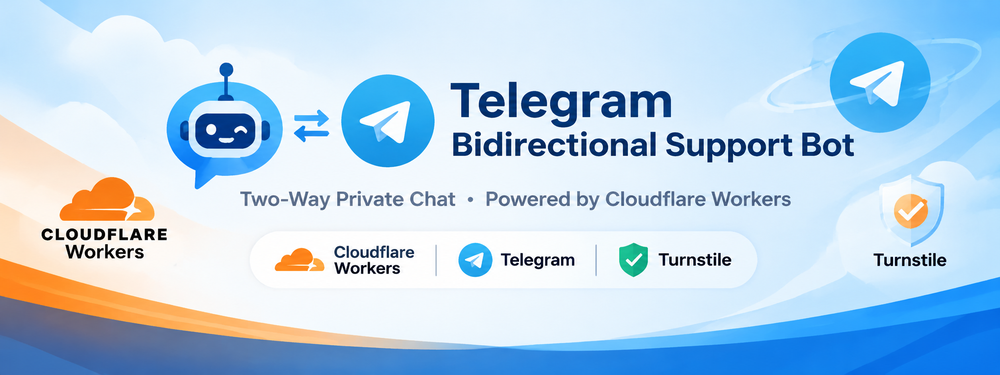

<p align="center">
  
</p>

# 🤖 Telegram 双向私聊客服机器人

基于 **Cloudflare Workers + Telegram Bot API + Cloudflare KV + Turnstile** 实现的双向私聊客服机器人。

无需购买服务器，无需使用 Durable Objects，即可实现 Telegram 用户与管理员之间的双向消息转发。每位用户自动分配一个独立的话题（Topic），管理员可以在超级群组中统一处理用户咨询。

## ✨ 核心功能

### 1. 双向消息转发

- 用户向机器人发送消息，自动转发到超级群组对应的话题。
- 管理员在对应话题中回复，机器人自动转发给用户。
- 每个用户拥有独立的话题，互不干扰。
- 支持文本、图片、视频、GIF、贴纸、语音、音频、文件等多种消息类型。
- 支持位置和联系人消息。
- 使用 Telegram `file_id` 转发媒体，无需下载和重新上传文件。

### 2. Cloudflare 人机验证

集成 Cloudflare Turnstile，防止机器人被恶意滥用。

- 用户首次使用需要完成验证。
- 通过 Telegram Mini App 打开验证页面。
- 验证由 Cloudflare 服务端进行校验。
- 验证通过后自动激活用户。
- 验证有效期为 **30 天**。
- 验证链接采用 HMAC-SHA256 签名。
- 验证链接有效期为 10 分钟。
- 同一验证链接只能使用一次，防止重复提交。

### 3. 用户独立话题管理

用户首次发送消息后，机器人自动在超级群组创建独立话题。

话题中自动生成用户资料卡片，包含：

- 用户昵称
- Telegram 用户 ID
- Telegram 用户名
- 话题名称
- 用户头像（如果可以获取）

管理员可以直接在对应话题中处理咨询。

### 4. 新消息通知卡片

自动创建一个全局的「📬 新消息」汇总话题，用于集中显示用户的新消息提醒。

通知卡片功能：

- 用户首次发消息时创建通知卡片。
- 显示用户昵称、账号和消息内容预览。
- 提供一键跳转用户话题的按钮。
- 支持跳转用户 Telegram 资料。
- 管理员可以手动忽略通知卡片。
- 同一用户 8 秒内只更新一次通知卡片。
- 优先编辑已有卡片，减少重复消息。
- 管理员回复后自动删除对应通知卡片。

### 5. 管理员管理指令

管理员可以直接在用户对应的话题中执行以下指令：

| 指令 | 功能 |
|---|---|
| `/ban` | 永久封禁当前用户 |
| `/unban` | 解除当前用户封禁 |
| `/close` | 关闭当前咨询，保留话题 |
| `/delete` | 彻底删除当前话题及相关记录 |

**指令说明：**

- `/ban`：封禁后，用户无法继续向机器人发送消息。
- `/unban`：解除封禁，恢复用户正常使用。
- `/close`：关闭当前话题，清理用户 KV 状态，并通知用户咨询已结束。
- `/delete`：删除当前话题、通知卡片及相关 KV 记录，并通知用户记录正在删除。

### 6. 自动恢复机制

针对 Telegram 话题被手动删除的情况，增加自动恢复机制。

当用户发送消息时，如果发现对应话题不存在：

1. 自动检测 Telegram 返回的错误。
2. 清理旧话题对应的 KV 映射。
3. 保留用户验证状态和封禁状态。
4. 自动创建新的用户话题。
5. 将当前消息重新发送到新话题。

避免因管理员误删话题导致用户无法继续咨询。

### 7. 消息提示优化

用户发送消息后，机器人会显示简洁的发送提示。

- 5 秒内多条消息合并显示。
- 自动累计已发送消息数量。
- 最后一条消息发送后 3 秒自动删除提示。
- 使用 Worker 内存缓存，不额外产生 KV 写入。

## 🏗️ 项目架构

```text
              Telegram 用户
                    │
                    ▼
              Telegram Bot
                    │
                    ▼
             Cloudflare Worker
                    │
          ┌─────────┼─────────┐
          │         │         │
          ▼         ▼         ▼
       消息转发   KV 存储   Turnstile
          │         │
          ▼         ▼
       超级群组   用户状态
          │
          ▼
     用户独立话题
          │
          ▼
       管理员回复
          │
          ▼
      Telegram 用户
```

### 使用的技术

| 技术 | 用途 |
|---|---|
| Cloudflare Workers | 服务端运行环境 |
| Cloudflare KV | 用户状态及话题映射存储 |
| Cloudflare Turnstile | 人机验证 |
| Telegram Bot API | 消息收发及话题管理 |
| Telegram Mini App | 内嵌验证页面 |
| Web Crypto API | HMAC-SHA256 签名 |

## ⚙️ 环境变量配置

部署前需要配置以下环境变量。

### 必填变量

| 变量名称 | 说明 |
|---|---|
| `BOT_TOKEN` | Telegram Bot Token |
| `SUPERGROUP_ID` | Telegram 超级群组 ID |
| `TURNSTILE_SITE_KEY` | Cloudflare Turnstile Site Key |
| `TURNSTILE_SECRET_KEY` | Cloudflare Turnstile Secret Key |
| `VERIFY_SECRET` | 验证链接 HMAC 签名密钥 |

### 可选变量

| 变量名称 | 说明 |
|---|---|
| `ADMIN_ID` | 管理员 Telegram 用户 ID |
| `REGISTER_SECRET` | Webhook 注册接口访问密钥 |

**注意：** `ADMIN_ID` 不配置时，代码默认允许所有群组成员执行管理操作，建议正式部署时务必配置管理员 ID。

### KV 命名空间

创建一个 Cloudflare KV 命名空间，并绑定以下变量：

| 绑定名称 | 类型 |
|---|---|
| `TOPIC_MAP` | KV Namespace |

## 🚀 部署教程

### 第一步：创建 Telegram Bot

1. 在 Telegram 中找到 [@BotFather](https://t.me/BotFather)。
2. 使用 `/newbot` 创建机器人。
3. 获取 Bot Token。
4. 将机器人添加到 Telegram 超级群组。

### 第二步：创建超级群组

1. 创建一个 Telegram 超级群组。
2. 开启群组话题（Topics）功能。
3. 将机器人添加到群组。
4. 授予机器人必要的管理权限，包括管理话题、发送消息、删除消息等。

### 第三步：配置 Cloudflare

1. 登录 [Cloudflare Dashboard](https://dash.cloudflare.com/)。
2. 创建一个 Workers 项目。
3. 创建一个 KV Namespace。
4. 将 KV 绑定名称设置为 `TOPIC_MAP`。
5. 在 Workers Settings → Variables and Secrets 中配置环境变量。

### 第四步：配置 Turnstile

1. 打开 [Cloudflare Turnstile](https://dash.cloudflare.com/?to=/:account/turnstile)。
2. 创建一个新的 Widget。
3. 配置允许访问的 Worker 域名。
4. 获取 Site Key 和 Secret Key。
5. 分别配置到 Worker 环境变量中。

### 第五步：部署代码

将项目代码粘贴到 Cloudflare Worker 编辑器中，保存并部署。

确保 Worker 已绑定 KV，并正确配置所有必填环境变量。

### 第六步：注册 Webhook

部署完成后，在浏览器访问：

```text
https://你的Worker域名/registerWebhook?key=你的REGISTER_SECRET
```

注册成功后，系统会自动：

- 设置 Telegram Webhook。
- 更新用户私聊命令菜单。
- 更新超级群组管理命令菜单。
- 丢弃积压的旧 Update。

返回 `Webhook & Commands Updated - Bot is Active` 即表示注册成功。

## 🔐 并发与稳定性设计

本项目不使用 Durable Objects，通过本地锁和 KV 状态管理降低并发问题。

主要采用以下策略：

- **Promise 内存锁**：同一 Worker isolate 内对用户操作进行串行处理。
- **用户级锁**：避免同一用户的状态同时被多个操作修改。
- **创建占位机制**：降低并发创建重复话题的概率。
- **二次状态确认**：创建话题后再次检查 KV 状态。
- **双读对账**：降低 KV 最终一致性导致的重复通知卡片问题。
- **失败重试**：KV 写入失败时自动重试一次。
- **超时控制**：Telegram API 请求设置 15 秒超时。
- **异常恢复**：检测话题不存在时自动重新创建。

## 📌 项目特点

- 无需独立服务器。
- 无需 Durable Objects。
- 基于 Cloudflare Workers 部署。
- 使用 KV 保存用户状态。
- 用户与管理员双向私聊。
- 每个用户自动分配独立话题。
- 集成人机验证，降低机器人滥用风险。
- 支持多种 Telegram 消息类型。
- 自动汇总新消息通知。
- 支持封禁、解封、结案和删除。
- 尽量减少不必要的 KV 写入。
- 适合个人客服、售后咨询及小型客服团队。

## ⚠️ 注意事项

1. 必须使用开启了话题功能的 Telegram 超级群组。
2. 机器人需要拥有对应的消息发送、话题管理和删除权限。
3. `VERIFY_SECRET` 必须使用足够长且随机的密钥。
4. `BOT_TOKEN`、`TURNSTILE_SECRET_KEY` 和 `VERIFY_SECRET` 不要公开。
5. 本项目使用 KV 和 Worker 内存锁，不具备 Durable Objects 的强一致性保证。
6. Cloudflare KV 存在最终一致性及跨节点并发限制，不能保证所有极端并发场景下绝对不重复创建话题。
7. Worker 内存缓存可能随 isolate 重启而丢失，这是正常现象。

## 📄 License

本项目暂未指定开源许可证。如需公开分发，请根据自己的使用需求添加 License 文件。
